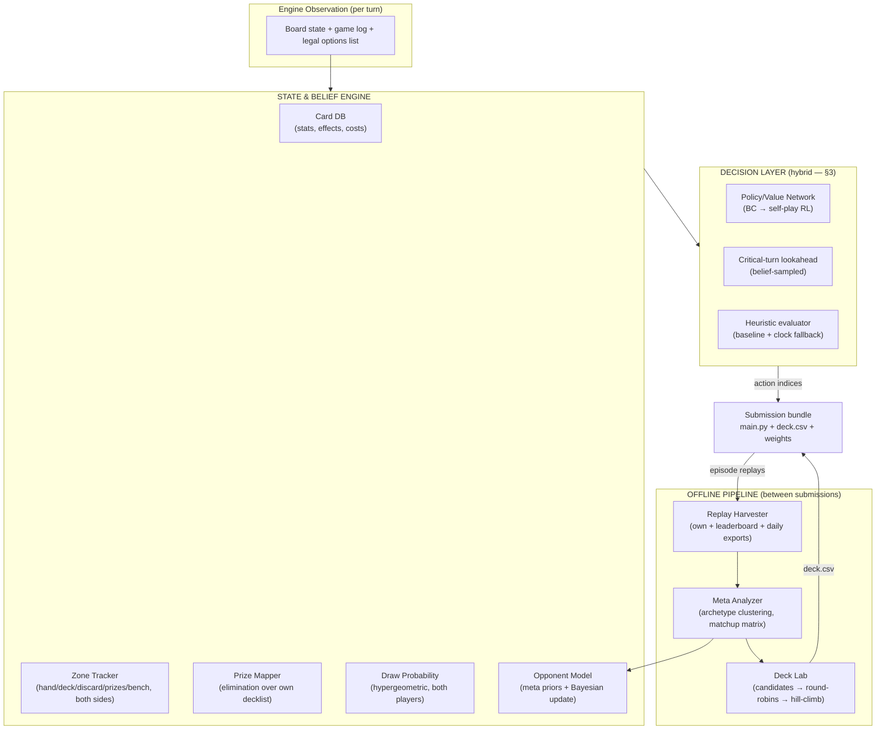

# PTCG AI Battle Challenge — Agent Strategy & Build Plan

**Status:** Architecture finalized. Ready for kickoff (§9).

---

## 1. Constraints & deadlines

| Item | Value |
|---|---|
| Simulation entry / team merger | **Aug 9, 2026** |
| Agent final submission | **Aug 16, 2026** (convergence period to ~Aug 31) |
| Strategy writeup deadline | **Sep 13, 2026** (2,000-word cap) |
| Runtime | 2 vCPUs, 12.2 GiB RAM, 10 min/player clock, no network during episodes |
| Bundle | `.tar.gz` ≤ 197.7 MiB, `main.py` at top level + `deck.csv`; files land in `/kaggle_simulations/agent/` |
| Ladder | TrueSkill-style N(μ,σ²), μ₀=600; only latest **2** submissions active; margin of victory irrelevant; draws count |
| Judging (Strategy) | Model Score 70% · Deck Score 20% · Report Score 10% — rationale, originality, consistency, and robustness weigh as much as rank |

Key environment facts: the cabt engine presents **only legal moves**; a local SDK mirrors the environment; episode replays are downloadable (own + leaderboard) and the organizers publish a **daily top-episode export explicitly to support BC/RL/IL**; documented rule differences exist between the simulator and official TCG.

---

## 2. Architecture overview

The strategic components (rules/card knowledge, meta awareness, prize mapping, draw probability, deck construction) form a shared **State & Belief Engine** — perception and inference. The **decision layer** consumes it and picks actions. Deck construction is a separate **offline pipeline** sharing the same evaluator (the agent itself).

The bottom loop is the flywheel: submissions generate replays → replays refresh the meta model and deck choices → better next submission.

---

## 3. Finalized layer stack

**Model-class resolution:** Bayesian methods and neural networks are different *layers*, not competing options. Bayesian/analytic math owns belief (known structure — counting, hypergeometric, Bayes over archetype priors; no training). A compact neural net owns decisions. Large autoregressive transformers are ruled out: wrong problem shape (turn-wise selection from a variable legal-option list) and incompatible with the compute envelope.

| # | Layer | Type | Input | Output |
|---|---|---|---|---|
| 1 | Perception | Pure code | Raw observation | Structured `GameState` |
| 2 | Belief | Bayesian/analytic | `GameState` + history + meta priors | `BeliefState`: hidden-zone distributions, threat model, prize path + race differential, deck-quality metric |
| 3 | Encoder | Small NN | Card embeddings per zone + scalars (incl. strategy objects) | State vector (128–256 d) |
| 4 | Policy/Value heads | Same NN | State vector + per-option encodings | Score per legal option + win probability |
| 5 | Arbitration | Pure code | Policy scores, value, clock | **Final action index** |

**Network (layers 3–4):** card embedding table (~2,000 vocab) + zone encoding; attention pooling per zone (zones are sets; 2–4 layer transformer *encoder*); pointer-style policy head scoring each legal option against the state vector (native handling of variable action lists + legality masking); value head for win probability. Budget: single-digit M params → few MB ONNX → sub-10ms CPU inference.

**Arbitration (layer 5):** routine turns → policy argmax. Critical turns (flagged by the prize-path object: KO windows, differential swings) → shallow lookahead with value-head evaluation over opponent hands **sampled from the belief layer**, few-second budget. Clock pressure → instant heuristic fallback. The compute budget is a managed strategic resource.

**Training path:**
1. **Behavioral cloning** — cross-entropy on *winners'* actions from the daily top-episode exports + harvested replays.
2. **Self-play RL (PPO)** against a pool (heuristic agent, older checkpoints, multiple decks) to prevent mirror-collapse.
3. Weekly retrain as replay volume grows; strategy-object features held fixed for clean ablations.

**Why hybrid wins:** pure heuristics cap out (organizers say so); pure search starves on 2 vCPUs if the forward model is slow; pure end-to-end NN wastes capacity relearning exactly-computable structure. Exact math where structure is known, learning where it isn't, named/ablatable strategy features — an original, defensible narrative for the 70% Model Score.

**Fallback ladder:** the heuristic evaluator is built first regardless — it is the week-2 ladder presence, the ablation baseline, the clock fallback inside layer 5, and the shipped agent if the ML path slips.

---

## 4. Play strategies as computable objects

Strategies are not scripted rules — each is an object the Belief Engine recomputes every turn.

### Prize mapping → a plan object
- Each opponent Pokémon = (prize value, estimated turns-to-KO given our output vs. their HP/heal/retreat).
- Per turn: solve cheapest target sequence summing to 6 prizes (tiny greedy/DP).
- Outputs `our_turns_to_6`, `their_turns_to_6`; the **prize-race differential** is the master evaluation signal.
- Emergent: spread damage valued when it enables multi-KO turns; declining a KO is correct when it worsens the differential (e.g., popping a 1-prize wall that accelerates opponent setup).

### Deck thinning → a metric
- Per-card **situational usefulness score** (state-conditional: energy early ≠ energy late).
- Deck quality = E[usefulness of next k draws] via the hypergeometric tracker.
- Every search/discard/draw effect valued by its **delta on deck quality**.
- Guardrail: deck-out risk term.

### Opponent prediction → a distribution
- Bayesian archetype classifier (meta priors, updated per revealed card) → archetype decklist template → subtract seen cards → hypergeometric over their deck + hand.
- Threat-model outputs: P(our active KO'd next turn), P(gust/switch in hand), expected incoming damage.
- The same distribution feeds critical-turn determinization sampling directly.

### Integration & measurement
| Consumer | How objects plug in |
|---|---|
| Heuristic evaluator | Weighted terms: prize differential + deck-quality delta + threat penalties |
| Critical-turn search | Leaf evaluation + move ordering; opponent distribution = determinization sampler |
| Policy network | Input features (safer than reward shaping, which distorts prize-taking) |

Figures for free: prize-path accuracy vs. actual game endings; deck-quality curves (thinning ablation); opponent-model prediction accuracy vs. replay ground truth; per-object on/off ablation ladder.

---

## 5. Deck construction (offline pipeline — no separate model)

Deck building is offline optimization with expensive evaluation (simulated games), not a runtime decision problem. No learned model; an optimization loop.

**Pipeline:**
1. **Mine the meta** — cluster leaderboard replays into archetypes; compute archetype shares, win rates, matchup matrix.
2. **Candidate pool (3–6 decks)** — top meta archetypes + 1–2 counter-meta builds; seeded from mining + filtered human tournament lists.
3. **Round-robin in the SDK** — every candidate vs. every candidate, ~200+ games per pairing (coin flips lie at small N), piloted by the current best agent.
4. **Select** by expected ladder win rate, weighted by observed meta frequency. Re-run on meta shifts.

**Seven-axis framework** — each deck's feature vector: aggressiveness · card draw · targeted attacks (gust/bench-hit) · energy acceleration · KO avoidance (retreat/heal/scoop) · disruption · stall (active-lock, energy removal, mill). Each axis scored two ways:
- **Static** (decklist + card DB): counts/quality of relevant effects — used to *generate* candidates.
- **Functional** (from simulated games): e.g., aggressiveness = median turn of first meaningful attack + avg prizes by turn 6 — used to *judge* candidates.

**Generation:** template + flex, not free search (60-of-2,000 free optimization is intractable). Candidate = archetype core (~35–45 cards) + flex slots steered by axis gaps. Improve via hill-climb: swap 2–4 flex cards → re-run match battery → keep if better.

**Agent–deck co-evolution (1–2 rounds max):** fix agent → deck tournament → pick winner → retrain/tune agent on that deck → re-validate.

**Archetype stances (decided):**
- **Stall: deprioritized archetype.** Not built as our deck (draws count in ratings, margin irrelevant, 10-min clock punishes long games, stall lines rare in BC data) — but still modeled in the opponent archetype classifier so the agent recognizes and counters it. Revisit only if meta mining shows stall overperforming.
- **Disruption: testable hypothesis.** Plausibly stronger vs. AI opponents than humans (brittle agents mishandle hand disruption). Test it.

**Final-slot strategy:** only the latest 2 submissions stay active — run two different decks if the meta is unstable, the same deck twice if confident.

Writeup payoff: radar chart per archetype on the seven axes; regression of ladder win rate on axis scores = "which axes the simulator meta actually rewards."

---

## 6. Human expert data: priors, not policy training

Supervised training on human *moves* isn't feasible — no public machine-readable logs of human PTCG decisions at scale. The competition's exports are the only BC dataset for policy. Human data slots in upstream:

| Source | Use | Pipeline step |
|---|---|---|
| Tournament decklists (Limitless TCG — free/public, satisfies external-data accessibility rule) | Seed Deck Lab candidates | Filter against competition card pool CSV (mandatory) → adapt → round-robin |
| Human archetype/matchup knowledge | Warm-start opponent-model priors before ladder replay volume exists | Archetype definitions + tell-card mappings |
| Pro strategy content (prize conventions, tempo, resource commitment) | Evaluation-function terms in the heuristic agent | Knowledge transfer, no data needed |

**Caveat → writeup angle:** the simulator meta will diverge from the human meta (rule differences, restricted pool, AI blind spots). Treat human knowledge as priors, then *measure* the divergence — "initialized from human expert play, quantified where the AI meta departed" is a strong hypothesis-test narrative.

---

## 7. Judging alignment & risk controls

1. **Experiment log from day one.** Model Score (70%) is mostly articulated rationale + tested hypotheses + demonstrated consistency. Per agent version: hypothesis, change, N games vs. fixed opponents, result. This becomes the writeup's spine.
2. **Robustness is explicitly judged.** Test across going first/second, mulligan-heavy starts, and every candidate archetype; report variance, not just mean win rate.
3. **Originality play = opponent inference.** Everyone will do hypergeometric draw math; fewer will do meta-prior Bayesian archetype identification with measured prediction accuracy.
4. **Time management is a component.** Per-move budget + fallback policy lives in layer 5, and gets described in the writeup.
5. **Simulator quirks first.** Read the documented rule differences before importing real-TCG intuition.
6. **Lock-in discipline.** Latest-2-active + σ convergence ⇒ freeze final agents by ~Aug 12; no risky uploads in the last week.
7. **IP compliance in the writeup.** Media gallery: abstract figures only (charts, diagrams, matrices) — **no card images or Pokémon artwork** (Pokémon Elements license; violations are grounds for disqualification). Keep the repo clean of card images throughout.
8. **BC label hygiene.** Train only on the winner's actions in exported episodes.
9. **Defensive engineering.** Crash = timeout = instant loss. Outermost layer of every agent: try/except + watchdog timer returning a legal fallback action. Build into the first real agent; never remove.
10. **Version control from day one.** Winners must deliver reproducible code (training + inference + env description) — a clean git repo is a prize requirement. Keep it free of card images/Card Data CSVs; competition data must be deleted at competition end.
11. **Submissions are cheapest early.** 5/day but only latest 2 active → burn submissions on experiments in July; each upload gets expensive in August.
12. **Watch the Discussion forum weekly.** Daily replay exports, rule clarifications, and meta talk land there — free information.
13. **Writeup folder from now.** 2,000 words is brutally short; the hard part is cutting. Every experiment drops its figure + two-sentence result into the folder as it happens → September = assembly, not archaeology.

---

## 8. Open questions

**Scope gates:**
- **SOLO — confirmed.** Consequences: July 19 minimum-shippable milestone is the backbone; training path re-prioritized to BC-first with self-play RL as stretch goal; 5 submissions/day are all ours. (Merger option stays open until Aug 9 if that changes.)
- **Training compute — resolved:** Kaggle GPUs (default, zero-friction) or UCSD lab servers (more power → makes solo self-play RL feasible). *Gate on lab servers:* clear personal-project use with advisor/lab policy first — prize competition + winner open-source obligations + rules requiring inventions not belong to the institution.

**Resolved (from cabt docs + kaggle-environments source, `kaggle_environments/envs/cabt/`):**
- **Clock:** `remainingOverageTime: 600` s per player, `actTimeout: 0` — all thinking time drains one bank; at zero → status `TIMEOUT` → reward −1, opponent +1. **Immediate loss**, same as a crash. Draws exist (reward 0). Deck ≠ exactly 60 cards → `INVALID`.
- **Observation structure:** `logs` + `current` (players, stadium, turn info) + `select` (options; indices = actions). Opponent hand = count only; prizes face-down (`None`); **discard pile fully visible**. Belief Engine design maps 1:1.
- **Native Search API:** `search_begin`/`search_step`/`search_end` — first-class state-transition exploration for critical-turn lookahead; week-1 benchmark = time `search_step`.
- **Agent interface is multi-select:** `agent(obs) -> list[int]`, choose `maxCount` from `select.option` — policy head must score option *sets* for some decisions (mulligans, prize picks, discards).

**Still open for week 1:**
- `search_step` speed benchmark (gates lookahead depth).
- Docker image packages (onnxruntime/torch → deployment path; ONNX-on-CPU is the safe bet).
- **Replay file contents:** do replays reveal hidden zones? *Verify:* download one replay JSON (Submissions tab or leaderboard), inspect for hidden-zone card IDs + full decklists.
- Opponent decklist recoverability (if not in replay file → fallback parser: union of cards-seen per submission).
- Current volume of the daily top-episode exports (BC viable now vs. phase 2).

---

## 9. Action items — kickoff

**Do today:**
1. Register for **both** competitions, accept rules (Simulation entry closes **Aug 9**).
2. Download SDK + card CSVs; replicate the Docker image locally.
3. Build + submit a **legal-random agent** — validates bundle format, `/kaggle_simulations/agent/` imports, Validation Episode.

**Week 1 (by ~Jul 12):**
4. Benchmark `search_step` speed (native Search API).
5. Inspect a downloaded replay file → hidden-zone visibility + decklist recoverability.
6. Check Docker image packages (onnxruntime/torch).
7. Stand up replay harvester (Kaggle CLI) + subscribe to daily exports.
8. Pull Limitless decklists → filter against card pool CSV.
9. Open the experiment log; entry #1 = random agent's baseline μ.
10. Read the simulator-vs-official-rules differences page + `kaggle_environments/envs/cabt/` source (the referee's code).
11. If using UCSD lab servers: clear personal-project use with advisor/lab policy (else default to Kaggle GPUs).

**Conditional (trigger when needed):**
- Decklist-fallback parser (union of cards-seen per opponent submission) — build only if replays don't contain decklists directly (pending item 5).

**Milestones:**
| Date | Milestone |
|---|---|
| ~Jul 12 | Week-1 unknowns resolved; random agent rated on ladder |
| ~Jul 19 | **Minimum shippable:** Belief Engine + heuristic agent + first validated deck on ladder; first meta report |
| ~Aug 2 | BC policy net trained + on ladder; deck round-robin v2; decision on critical-turn search depth |
| ~Aug 10–12 | Self-play refinement done; **freeze final two submissions** (best + most stable) |
| Aug 16 | Submission lock (buffer already banked) |
| Aug 17 – Sep 6 | Robustness experiments, ablations, figures |
| Sep 13 | Writeup submitted (target draft ~Sep 6) |

**Monte Carlo — three distinct uses (shared name, different techniques):**
1. Self-play simulated games → RL training fuel + deck round-robins + all ablations.
2. Hidden-information sampling at decision time → opponent hands drawn from belief distributions on critical turns.
3. MCTS-style lookahead → optional, gated on the step-speed benchmark.
