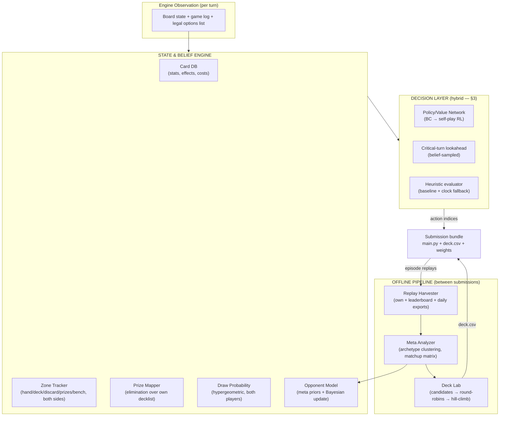

# PTCG AI Battle Challenge — Agent Strategy & Build Plan

**Status:** Architecture finalized. Ready for kickoff (§9).

---

## 1. Constraints & deadlines

| Item | Value |
|---|---|
| Simulation entry / team merger | **Aug 9, 2026** |
| Agent final submission | **Aug 16, 2026** (convergence period to ~Aug 31) |
| Strategy writeup deadline | **Sep 13, 2026** (2,000-word cap) |
| Runtime | 2 vCPUs, 12.2 GiB RAM, 10 min/player clock, no network during episodes |
| Bundle | `.tar.gz` ≤ 197.7 MiB, `main.py` at top level + `deck.csv`; files land in `/kaggle_simulations/agent/` |
| Ladder | TrueSkill-style N(μ,σ²), μ₀=600; only latest **2** submissions active; margin of victory irrelevant; draws count |
| Judging (Strategy) | Model Score 70% · Deck Score 20% · Report Score 10% — rationale, originality, consistency, and robustness weigh as much as rank |

Key environment facts: the cabt engine presents **only legal moves**; a local SDK mirrors the environment; episode replays are downloadable (own + leaderboard) and the organizers publish a **daily top-episode export explicitly to support BC/RL/IL**; documented rule differences exist between the simulator and official TCG.

---

## 2. Architecture overview

The strategic components (rules/card knowledge, meta awareness, prize mapping, draw probability, deck construction) form a shared **State & Belief Engine** — perception and inference. The **decision layer** consumes it and picks actions. Deck construction is a separate **offline pipeline** sharing the same evaluator (the agent itself).

The bottom loop is the flywheel: submissions generate replays → replays refresh the meta model and deck choices → better next submission.

---

## 3. Finalized layer stack

**Model-class resolution:** Bayesian methods and neural networks are different *layers*, not competing options. Bayesian/analytic math owns belief (known structure — counting, hypergeometric, Bayes over archetype priors; no training). A compact neural net owns decisions. Large autoregressive transformers are ruled out: wrong problem shape (turn-wise selection from a variable legal-option list) and incompatible with the compute envelope.

| # | Layer | Type | Input | Output |
|---|---|---|---|---|
| 1 | Perception | Pure code | Raw observation | Structured `GameState` |
| 2 | Belief | Bayesian/analytic | `GameState` + history + meta priors | `BeliefState`: hidden-zone distributions, threat model, prize path + race differential, deck-quality metric |
| 3 | Encoder | Small NN | Card embeddings per zone + scalars (incl. strategy objects) | State vector (128–256 d) |
| 4 | Policy/Value heads | Same NN | State vector + per-option encodings | Score per legal option + win probability |
| 5 | Arbitration | Pure code | Policy scores, value, clock | **Final action index** |

**Network (layers 3–4):** card embedding table (~2,000 vocab) + zone encoding; attention pooling per zone (zones are sets; 2–4 layer transformer *encoder*); pointer-style policy head scoring each legal option against the state vector (native handling of variable action lists + legality masking); value head for win probability. Budget: single-digit M params → few MB ONNX → sub-10ms CPU inference.

**Arbitration (layer 5):** routine turns → policy argmax. Critical turns (flagged by the prize-path object: KO windows, differential swings) → shallow lookahead with value-head evaluation over opponent hands **sampled from the belief layer**, few-second budget. Clock pressure → instant heuristic fallback. The compute budget is a managed strategic resource.

**Training path:**
1. **Behavioral cloning** — cross-entropy on *winners'* actions from the daily top-episode exports + harvested replays.
2. **Self-play RL (PPO)** against a pool (heuristic agent, older checkpoints, multiple decks) to prevent mirror-collapse.
3. Weekly retrain as replay volume grows; strategy-object features held fixed for clean ablations.

**Why hybrid wins:** pure heuristics cap out (organizers say so); pure search starves on 2 vCPUs if the forward model is slow; pure end-to-end NN wastes capacity relearning exactly-computable structure. Exact math where structure is known, learning where it isn't, named/ablatable strategy features — an original, defensible narrative for the 70% Model Score.

**Fallback ladder:** the heuristic evaluator is built first regardless — it is the week-2 ladder presence, the ablation baseline, the clock fallback inside layer 5, and the shipped agent if the ML path slips.

---

## 3c. Search deepened: network-guided determinized MCTS (AlphaZero-style)

Adopted after ladder evidence that one-ply evaluation fails on plan-ahead decks (evolution lines, energy ramp): correct setup moves look bad locally and pay off turns later. This deepens §3b's "critical-turn lookahead" into full MCTS; nothing else in the stack changes.

**Two PTCG deviations from AlphaGo:**
1. *Hidden information* → **determinized MCTS**: per decision, sample K (~4–8) complete worlds (opponent hand, deck orders, prizes) from the Belief Engine, search each, aggregate action stats. The Bayesian layer IS the determinization sampler — better beliefs → better search. Upgrade path to IS-MCTS if strategy-fusion artifacts appear.
2. *Chance nodes* (coin flips, draws): stochastic events averaged by resampling; verify how native search_step resolves randomness.

**Spec:** one net, two heads (policy prior + value) over belief-state features; PUCT selection (Q + c·P·√N/(1+n)); leaves scored by value head, with truncated heuristic rollouts as a cross-check until the net beats them (retirement comparison = writeup figure). Governor (layer 5) allocates: routine turns = policy argmax; critical turns (prize-path triggers) = K determinizations × a few hundred sims in ~5s; clock pressure = heuristic fallback. ~10–20 deep turns/game fits the 10-min bank on 2 vCPUs.

**Training = expert iteration:** BC on winner actions/outcomes (AlphaGo's SL phase) → self-play games played BY the MCTS agent, net trained to match search visit distributions + outcomes (AlphaZero loop). Planning knowledge distills into the fast policy path. Server-gated: game generation is embarrassingly parallel CPU work.

**Strategy objects' three jobs here:** encoder features (exact math not relearned); search infrastructure (belief sampler + critical-turn trigger); interpretability for judges (visit counts + named features explain WHY the setup line was chosen).

**Phases:** (A) MCTS-H — uniform priors + heuristic leaves, no nets, unblocks planning immediately; benchmark sims/sec first. (B) MCTS-Net — BC net as priors/leaf eval, ladder A/B vs A. (C) Expert iteration, lab-server-gated.

## 3d. Multi-deck pilot framework (phase 1)

**Motivation (from experiment #32).** The gen-1 net is trained on *sample-deck self-play only*, so it is out-of-distribution piloting any other deck: net-MCTS piloting `dragapult-dusknoir` lost to the same net piloting `sample` 19.7% (z=−6.41). That result is confounded — it measures a blind pilot, not a weak deck — and it caps the whole deck-construction arc behind "the net can't play anything but sample". The fix is a pilot that *knows more than one deck*. This §3d is the phase-1 build to get there; it does not change the shipped stack until its gate passes.

**Design principle.** Keep the exact-math / learned split of §3. We do *not* hand-script the shipped agent — the scripted line-experts here are (a) a BC teacher signal and (b) a per-archetype validation baseline, exactly the role §3c's "truncated heuristic rollouts as a cross-check until the net beats them" plays. The net still owns the decisions; the experts bootstrap it onto new decks and are then retired.

**Build steps (experiments #33+):**
1. **Deck-conditioned features.** Extend `src/nn/features.py` so `encode_state` also carries an *own-decklist summary* (the pilot must condition on what deck it is playing) + an *archetype embedding id*. **Version the feature schema** (a `SCHEMA_VERSION` constant + shape metadata) so v5's ONNX loader keeps working against the old schema while training moves to the new one.
2. **Scripted line-experts** (`src/experts/`, one per archetype; start with `dragapult-dusknoir` and `basic-box-m`). Each executes the known skeleton lines: Rare Candy on the first legal turn, energy onto the planned attacker, Crispin before attacking, Phantom Dive spread onto targets inside next-turn KO range (read from the prize object), Boss's Orders only when it converts a prize. **Gate each expert: it must beat v1 while piloting its own archetype** — else the teacher signal is worthless.
3. **Mixed buffer.** Extend `src/selfplay/recorder.py` to generate across a *deck pool* (sample + the 2 archetypes) × an *opponent pool* (v5 net, v4 heuristic, the scripted experts) over all seat pairings, recording the deck-conditioning features from step 1.
4. **Auxiliary targets.** The trainer adds aux value heads alongside game outcome z: *prize differential at t+3 turns* and *turns-to-first-attack* — denser, deck-agnostic learning signal that directly rewards the setup lines the experts demonstrate.
5. **Pretrain then train.** Behavioral-cloning pass on scripted-expert games first, then standard AlphaZero training on the mixed buffer. **Gate:** (a) net-MCTS piloting `dragapult-dusknoir` vs v5 piloting it — must improve *materially*; (b) net-MCTS on `sample` vs v5 on `sample` — must *not regress*; (c) `line_audit` execution rates before/after.
6. **BC-data reconnaissance.** Check the current volume of the Kaggle daily top-episode exports and report whether a behavioral-cloning dataset from top ladder agents is now viable (§3 training path step 1, so far unrealized).

**Success = the confound is gone:** a net that plays `dragapult-dusknoir` competently lets us re-run #32 as a *clean* deck test (equal-sims, in-distribution pilot both sides) and finally separate "weaker deck" from "blind pilot". If a constructed deck then still loses, the deck arc closes for real; if one wins, deck construction re-opens.

## 3e. Flywheel gen-3: field-inclusive self-play (SCOPE)

**Motivation (experiments #48, #52).** The shipped Alakazam net line (net_ladder2 → net_ladder3) was self-played **Alakazam-vs-Alakazam only** — its value head has never seen a field-facing position. Two results now bound the alternatives: (a) net_ladder3 is *offline-stronger* than net_ladder2 as an Alakazam pilot, mirror **and** field (#48), so the live v7<v6 gap is rating path-dependence, not net skill; (b) the determinizer opponent-model wins **attenuate under the net pilot** — +6% (heuristic) → +5% (net) vs the field, **0% in the mirror** (#52). So the determinizer lever is ~tapped at ~+5%; **the un-attenuated lever is the net's own field play.** Gen-3 teaches the net to pilot Alakazam well against the *diverse field*, not just the mirror.

**What already exists (no new recording infra needed).** `record_mixed_game` (`src/selfplay/recorder.py`) already plays **asymmetric** games — a different deck AND pilot per seat — and records deck-conditioned decisions for both movers (policy = MCTS visits, value = game outcome, per-mover perspective). The flywheel `--deck` mode just *restricts* it to a mirror. Gen-3 = a field matchup mix on top of the existing recorder, plus a training-recipe and a field-inclusive gate.

**Design decisions (recommended):**
1. **Matchup mix = ladder-proportional.** Our seat is always **Alakazam piloted by net_ladder3** (the strongest teacher — self-play quality tracks pilot strength). The opponent seat is drawn from the real ladder field: ~⅓ Alakazam (mirror, keep the competence we have — the #40 dilution lesson), ~⅔ field weighted by ladder share — Mega Kangaskhan (15%), Grimmsnarl (13%), Lucario / Garchomp / Archaludon / Cornerstone (~5% each). Modal decklists mined via `scripts/extract_decks.py` (Kangaskhan/Garchomp/Grimmsnarl done; Lucario/Archaludon/Ogerpon extracting).
2. **Field opponent pilot = heuristic MCTS.** Deck-agnostic, needs no trained field net (our nets are OOD piloting field decks). Limitation to log: heuristic field play is weaker than the live field, so gen-3 learns to beat *heuristic-level* field — but the **value targets** (did Alakazam win from this field-facing board?) are field-realistic, which is exactly what the value head needs to calibrate. This is a strict improvement over mirror-only value.
3. **Record only the Alakazam seat.** The recorder emits both seats' rows; keep only Alakazam-deck rows (filter by `deck_summary`) so we do NOT train the net to pilot field decks we never ship (#40 dilution guard). Field-seat rows are discarded.
4. **Training.** Base = **net_ladder3**. Buffer = existing Alakazam mirror self-play (52k) + **new field-facing Alakazam self-play** (target ~30–50k rows) + ladder-BC (`--mask-bc-value`, policy only, as #42). Value head trains on real outcomes from mirror **and** field games → calibrated on field-facing leaves. Keep mirror volume comparable so mirror play doesn't regress.
5. **Gate = FIELD-INCLUSIVE (the #48/#52 lesson).** The acceptance test is `scripts/gate_net_field.py`: gen-3 vs net_ladder3 AND vs net_ladder2, our Alakazam pilot **facing the field decks** (+ mirror control). Gen-3 must beat net_ladder3 **vs the field** (not just the mirror) to ship — a mirror-only gate is exactly what over-sold net_ladder3 and is not trusted again.

**Phases:** (1) finish the field deck pool (extract Lucario/Archaludon/Ogerpon). (2) field self-play driver = `record_mixed` with a field SIDES config (Alakazam/net vs each field deck/heuristic) + a `deck_summary` filter to Alakazam rows. (3) generate ~750 games (~1.5 h at 8 workers, sims=160 — CPU self-play is the bottleneck, GPU still not worth it). (4) train gen-3 from net_ladder3. (5) field-inclusive gate → export ONNX → **v11** if it beats net_ladder3 vs the field. 

**Open decisions:** base net (net_ladder3 primary; a net_ladder2 fork is a cheap alternative given its higher *live* rating); whether to also record field-seat rows as a deck-conditioned bonus (risk: #40 dilution — default no); a stronger field pilot than heuristic later (a self-played field net) if gen-3's heuristic-field ceiling shows.

## 4. Play strategies as computable objects

Strategies are not scripted rules — each is an object the Belief Engine recomputes every turn.

### Prize mapping → a plan object
- Each opponent Pokémon = (prize value, estimated turns-to-KO given our output vs. their HP/heal/retreat).
- Per turn: solve cheapest target sequence summing to 6 prizes (tiny greedy/DP).
- Outputs `our_turns_to_6`, `their_turns_to_6`; the **prize-race differential** is the master evaluation signal.
- Emergent: spread damage valued when it enables multi-KO turns; declining a KO is correct when it worsens the differential (e.g., popping a 1-prize wall that accelerates opponent setup).

### Deck thinning → a metric
- Per-card **situational usefulness score** (state-conditional: energy early ≠ energy late).
- Deck quality = E[usefulness of next k draws] via the hypergeometric tracker.
- Every search/discard/draw effect valued by its **delta on deck quality**.
- Guardrail: deck-out risk term.

### Opponent prediction → a distribution
- Bayesian archetype classifier (meta priors, updated per revealed card) → archetype decklist template → subtract seen cards → hypergeometric over their deck + hand.
- Threat-model outputs: P(our active KO'd next turn), P(gust/switch in hand), expected incoming damage.
- The same distribution feeds critical-turn determinization sampling directly.

### Integration & measurement
| Consumer | How objects plug in |
|---|---|
| Heuristic evaluator | Weighted terms: prize differential + deck-quality delta + threat penalties |
| Critical-turn search | Leaf evaluation + move ordering; opponent distribution = determinization sampler |
| Policy network | Input features (safer than reward shaping, which distorts prize-taking) |

Figures for free: prize-path accuracy vs. actual game endings; deck-quality curves (thinning ablation); opponent-model prediction accuracy vs. replay ground truth; per-object on/off ablation ladder.

---

### Predictive disruption → a fourth strategy object (added post-meta-analysis)

Not the deprioritized stall archetype — a tempo weapon: use the opponent model's forecast to *time* disruption cards (Items, Supporters, Stadiums, ACE SPECs, Tools). Meta data confirms pool support: Special Red Card, Unfair Stamp, Crushing/Enhanced Hammer, Jamming Tower, Team Rocket's Watchtower all run at high rates in top human lists.

**Disruption Planner (runtime object):** per disruption card in hand each turn,
`EDV = Σ_plays P(play next turn | opponent model) × Δ(their turns-to-6 if disrupted) − our tempo cost`.
Play at local EDV maxima: Red Card when their estimated hand is large; Hammer when their attacker is one energy from attacking; Unfair Stamp on a KO into a built-up hand; Jamming Tower vs tool-reliant archetypes. Consumes existing belief-engine outputs (threat forecast, hand estimate, energy curves) + prize-race deltas.

**Disruption Coverage Score (deck metric — upgrades the 'disruption' axis):**
per-archetype *vulnerability profiles* from priors (basic-energy fragility, ability reliance, tool reliance, draw-engine dependence), then
`DCS = Σ_archetypes meta_share × effectiveness(our best answer, their profile)`.
Static version from skeleton CSVs + card DB (available pre-round-robin); functional version = measured delta in opponents' first-attack turn and turns-to-6 with disruption package in vs out. Both feed Deck Lab scoring; the ablation doubles as a writeup figure and directly tests the 'disruption is stronger vs AI opponents' hypothesis.

## 5. Deck construction (offline pipeline — no separate model)

Deck building is offline optimization with expensive evaluation (simulated games), not a runtime decision problem. No learned model; an optimization loop.

**Pipeline:**
1. **Mine the meta** — cluster leaderboard replays into archetypes; compute archetype shares, win rates, matchup matrix.
2. **Candidate pool (3–6 decks)** — top meta archetypes + 1–2 counter-meta builds; seeded from mining + filtered human tournament lists.
3. **Round-robin in the SDK** — every candidate vs. every candidate, ~200+ games per pairing (coin flips lie at small N), piloted by the current best agent.
4. **Select** by expected ladder win rate, weighted by observed meta frequency. Re-run on meta shifts.

**Seven-axis framework** — each deck's feature vector: aggressiveness · card draw · targeted attacks (gust/bench-hit) · energy acceleration · KO avoidance (retreat/heal/scoop) · disruption · stall (active-lock, energy removal, mill). Each axis scored two ways:
- **Static** (decklist + card DB): counts/quality of relevant effects — used to *generate* candidates.
- **Functional** (from simulated games): e.g., aggressiveness = median turn of first meaningful attack + avg prizes by turn 6 — used to *judge* candidates.

**Generation:** template + flex, not free search (60-of-2,000 free optimization is intractable). Candidate = archetype core (~35–45 cards) + flex slots steered by axis gaps. Improve via hill-climb: swap 2–4 flex cards → re-run match battery → keep if better.

**Agent–deck co-evolution (1–2 rounds max):** fix agent → deck tournament → pick winner → retrain/tune agent on that deck → re-validate.

**Archetype stances (decided):**
- **Stall: deprioritized archetype.** Not built as our deck (draws count in ratings, margin irrelevant, 10-min clock punishes long games, stall lines rare in BC data) — but still modeled in the opponent archetype classifier so the agent recognizes and counters it. Revisit only if meta mining shows stall overperforming.
- **Disruption: testable hypothesis.** Plausibly stronger vs. AI opponents than humans (brittle agents mishandle hand disruption). Test it.

**Final-slot strategy:** only the latest 2 submissions stay active — run two different decks if the meta is unstable, the same deck twice if confident.

Writeup payoff: radar chart per archetype on the seven axes; regression of ladder win rate on axis scores = "which axes the simulator meta actually rewards."

---

## 6. Human expert data: priors, not policy training

Supervised training on human *moves* isn't feasible — no public machine-readable logs of human PTCG decisions at scale. The competition's exports are the only BC dataset for policy. Human data slots in upstream:

| Source | Use | Pipeline step |
|---|---|---|
| Tournament decklists (Limitless TCG — free/public, satisfies external-data accessibility rule) | Seed Deck Lab candidates | Filter against competition card pool CSV (mandatory) → adapt → round-robin |
| Human archetype/matchup knowledge | Warm-start opponent-model priors before ladder replay volume exists | Archetype definitions + tell-card mappings |
| Pro strategy content (prize conventions, tempo, resource commitment) | Evaluation-function terms in the heuristic agent | Knowledge transfer, no data needed |

**Caveat → writeup angle:** the simulator meta will diverge from the human meta (rule differences, restricted pool, AI blind spots). Treat human knowledge as priors, then *measure* the divergence — "initialized from human expert play, quantified where the AI meta departed" is a strong hypothesis-test narrative.

---

## 7. Judging alignment & risk controls

1. **Experiment log from day one.** Model Score (70%) is mostly articulated rationale + tested hypotheses + demonstrated consistency. Per agent version: hypothesis, change, N games vs. fixed opponents, result. This becomes the writeup's spine.
2. **Robustness is explicitly judged.** Test across going first/second, mulligan-heavy starts, and every candidate archetype; report variance, not just mean win rate.
3. **Originality play = opponent inference.** Everyone will do hypergeometric draw math; fewer will do meta-prior Bayesian archetype identification with measured prediction accuracy.
4. **Time management is a component.** Per-move budget + fallback policy lives in layer 5, and gets described in the writeup.
5. **Simulator quirks first.** Read the documented rule differences before importing real-TCG intuition.
6. **Lock-in discipline.** Latest-2-active + σ convergence ⇒ freeze final agents by ~Aug 12; no risky uploads in the last week.
7. **IP compliance in the writeup.** Media gallery: abstract figures only (charts, diagrams, matrices) — **no card images or Pokémon artwork** (Pokémon Elements license; violations are grounds for disqualification). Keep the repo clean of card images throughout.
8. **BC label hygiene.** Train only on the winner's actions in exported episodes.
9. **Defensive engineering.** Crash = timeout = instant loss. Outermost layer of every agent: try/except + watchdog timer returning a legal fallback action. Build into the first real agent; never remove.
10. **Version control from day one.** Winners must deliver reproducible code (training + inference + env description) — a clean git repo is a prize requirement. Keep it free of card images/Card Data CSVs; competition data must be deleted at competition end.
11. **Submissions are cheapest early.** 5/day but only latest 2 active → burn submissions on experiments in July; each upload gets expensive in August.
12. **Watch the Discussion forum weekly.** Daily replay exports, rule clarifications, and meta talk land there — free information.
13. **Writeup folder from now.** 2,000 words is brutally short; the hard part is cutting. Every experiment drops its figure + two-sentence result into the folder as it happens → September = assembly, not archaeology.

---

## 8. Open questions

**Scope gates:**
- **SOLO — confirmed.** Consequences: July 19 minimum-shippable milestone is the backbone; training path re-prioritized to BC-first with self-play RL as stretch goal; 5 submissions/day are all ours. (Merger option stays open until Aug 9 if that changes.)
- **Training compute — resolved:** Kaggle GPUs (default, zero-friction) or UCSD lab servers (more power → makes solo self-play RL feasible). *Gate on lab servers:* clear personal-project use with advisor/lab policy first — prize competition + winner open-source obligations + rules requiring inventions not belong to the institution.

**Resolved (from cabt docs + kaggle-environments source, `kaggle_environments/envs/cabt/`):**
- **Clock:** `remainingOverageTime: 600` s per player, `actTimeout: 0` — all thinking time drains one bank; at zero → status `TIMEOUT` → reward −1, opponent +1. **Immediate loss**, same as a crash. Draws exist (reward 0). Deck ≠ exactly 60 cards → `INVALID`.
- **Observation structure:** `logs` + `current` (players, stadium, turn info) + `select` (options; indices = actions). Opponent hand = count only; prizes face-down (`None`); **discard pile fully visible**. Belief Engine design maps 1:1.
- **Native Search API:** `search_begin`/`search_step`/`search_end` — first-class state-transition exploration for critical-turn lookahead; week-1 benchmark = time `search_step`.
- **Agent interface is multi-select:** `agent(obs) -> list[int]`, choose `maxCount` from `select.option` — policy head must score option *sets* for some decisions (mulligans, prize picks, discards).

**Still open for week 1:**
- `search_step` speed benchmark (gates lookahead depth).
- Docker image packages (onnxruntime/torch → deployment path; ONNX-on-CPU is the safe bet).
- **Replay file contents:** do replays reveal hidden zones? *Verify:* download one replay JSON (Submissions tab or leaderboard), inspect for hidden-zone card IDs + full decklists.
- Opponent decklist recoverability (if not in replay file → fallback parser: union of cards-seen per submission).
- Current volume of the daily top-episode exports (BC viable now vs. phase 2).

---

## 9. Action items — kickoff

**Do today:**
1. Register for **both** competitions, accept rules (Simulation entry closes **Aug 9**).
2. Download SDK + card CSVs; replicate the Docker image locally.
3. Build + submit a **legal-random agent** — validates bundle format, `/kaggle_simulations/agent/` imports, Validation Episode.

**Week 1 (by ~Jul 12):**
4. Benchmark `search_step` speed (native Search API).
5. Inspect a downloaded replay file → hidden-zone visibility + decklist recoverability.
6. Check Docker image packages (onnxruntime/torch).
7. Stand up replay harvester (Kaggle CLI) + subscribe to daily exports.
8. Pull Limitless decklists → filter against card pool CSV.
9. Open the experiment log; entry #1 = random agent's baseline μ.
10. Read the simulator-vs-official-rules differences page + `kaggle_environments/envs/cabt/` source (the referee's code).
11. If using UCSD lab servers: clear personal-project use with advisor/lab policy (else default to Kaggle GPUs).

**Conditional (trigger when needed):**
- Decklist-fallback parser (union of cards-seen per opponent submission) — build only if replays don't contain decklists directly (pending item 5).

**Milestones:**
| Date | Milestone |
|---|---|
| ~Jul 12 | Week-1 unknowns resolved; random agent rated on ladder |
| ~Jul 19 | **Minimum shippable:** Belief Engine + heuristic agent + first validated deck on ladder; first meta report |
| ~Aug 2 | BC policy net trained + on ladder; deck round-robin v2; decision on critical-turn search depth |
| ~Aug 10–12 | Self-play refinement done; **freeze final two submissions** (best + most stable) |
| Aug 16 | Submission lock (buffer already banked) |
| Aug 17 – Sep 6 | Robustness experiments, ablations, figures |
| Sep 13 | Writeup submitted (target draft ~Sep 6) |

**Monte Carlo — three distinct uses (shared name, different techniques):**
1. Self-play simulated games → RL training fuel + deck round-robins + all ablations.
2. Hidden-information sampling at decision time → opponent hands drawn from belief distributions on critical turns.
3. MCTS-style lookahead → optional, gated on the step-speed benchmark.
